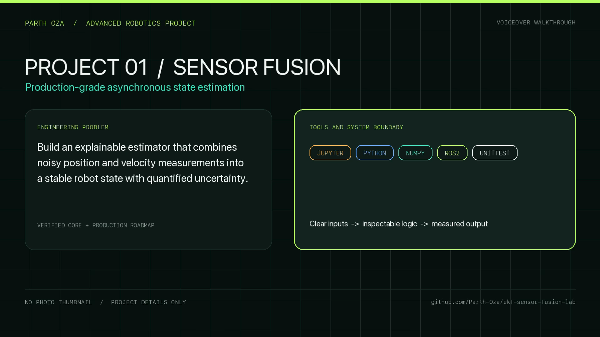
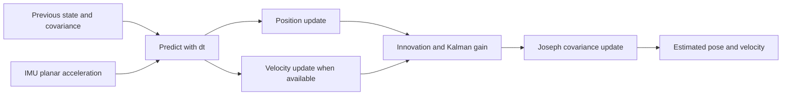

# EKF Sensor Fusion Lab

[](https://github.com/Parth-Oza/ekf-sensor-fusion-lab/actions/workflows/test.yml)
[](https://www.python.org/)
[](LICENSE)

A compact, testable state-estimation laboratory for fusing noisy position and velocity measurements in two dimensions. The implementation favors readable mathematics, deterministic experiments, and numerical stability over framework-specific abstractions.

> All measurements and trajectories are synthetic. This independent portfolio project contains no employer code, maps, logs, sensor calibration, or operational data.

## Technical walkthrough

[](docs/media/ekf-sensor-fusion-walkthrough.mp4)

The four-minute English walkthrough explains the engineering problem, state and covariance models, prediction and correction equations, implementation choices, reproducible experiment, and extension path. See [Evidence](docs/EVIDENCE.md) for the exact verification record and limitations.

## Capabilities

- Tracks the state vector `[x, y, vx, vy]` with a constant-velocity motion model.
- Supports asynchronous position and velocity measurement updates.
- Builds process noise from acceleration variance and elapsed time.
- Uses a linear solve instead of an explicit matrix inverse.
- Applies the Joseph covariance update and a symmetry guard.
- Includes seeded simulation, RMSE reporting, validation, and regression tests.
- Replays standard ROS 2 IMU and odometry from SQLite or MCAP rosbag2 recordings.
- Exports timestamped estimate/reference trajectories and replay residual metrics.



## Quick start

```bash
python -m venv .venv
source .venv/bin/activate
python -m pip install -e .
ekf-demo
python -m unittest discover -s tests -v
```

The demo prints raw position RMSE, filtered position RMSE, and improvement percentage for a seeded synthetic trajectory.

## ROS 2 bag replay

Run the checked-in, synthetic rosbag2 MCAP fixture:

```bash
ekf-bag-replay examples/ros2_bag_fixture --output-dir replay-output
```

This writes:

- `replay-output/trajectory.csv`: nanosecond timestamps, EKF pose/velocity, odometry reference, and position residual;
- `replay-output/metrics.json`: message counts, duration, residual RMSE, and maximum residual.

Topic mapping is explicit and configurable:

| Default topic | Required message type | Fields used |
|---|---|---|
| `/imu/data` | `sensor_msgs/msg/Imu` | `linear_acceleration.x`, `linear_acceleration.y` |
| `/odom` | `nav_msgs/msg/Odometry` | planar position and linear velocity |

```bash
ekf-bag-replay my_bag --imu-topic /robot/imu --odometry-topic /robot/odom
```

The input may be a rosbag2 directory or its SQLite/MCAP storage file. Messages are replayed in timestamp order using their recorded nanosecond timestamps. The planar IMU acceleration must already be gravity-compensated and expressed in the same frame as odometry; this example does not perform TF lookup, orientation compensation, or bias calibration.

The included fixture is intentionally tiny and synthetic. Rebuild it at any time with:

```bash
python -m ekf_sensor_fusion.rosbag_fixture /tmp/ekf_ros2_bag_fixture
```

`position_residual_*` compares the corrected estimate with the odometry measurement used as its reference. It is a replay-consistency metric, not independent ground-truth accuracy.

## Library usage

```python
from ekf_sensor_fusion import ConstantVelocityEKF

filter_ = ConstantVelocityEKF(acceleration_variance=0.2)
filter_.predict(dt=0.1)
filter_.update_position([1.3, -0.2], variance=0.64)
filter_.update_velocity([1.1, -0.3], variance=0.0324)

print(filter_.state)
print(filter_.covariance)
```

`dt` and measurement variance must be positive. Position and velocity measurements must each contain two values.

## Project layout

```text
src/ekf_sensor_fusion/ekf.py         Filter state, prediction, and updates
src/ekf_sensor_fusion/simulation.py  Seeded synthetic experiment and CLI
src/ekf_sensor_fusion/bag_replay.py  rosbag2 replay and CSV/JSON export
src/ekf_sensor_fusion/rosbag_fixture.py  Deterministic fixture generator
examples/ros2_bag_fixture/           Four-message ROS 2 MCAP fixture
tests/test_ekf.py                    Numerical and validation tests
tests/test_bag_replay.py             Standard-message integration tests
docs/ARCHITECTURE.md                 Mathematical model and extension notes
```

## Engineering principles

- Make state, covariance, and noise assumptions visible.
- Prefer deterministic simulation over visually impressive but irreproducible demos.
- Test numerical properties and invalid inputs.
- Keep ROS2 transport at the boundary of the mathematical core.

See [Architecture](docs/ARCHITECTURE.md), [Evidence](docs/EVIDENCE.md), [Contributing](CONTRIBUTING.md), and [Security](SECURITY.md).

## Contact

For professional opportunities and technical discussions: [ozaparthu055@gmail.com](mailto:ozaparthu055@gmail.com) · [Portfolio](https://parthoza.net) · [LinkedIn](https://www.linkedin.com/in/oza-parth)
